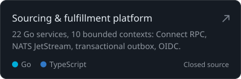
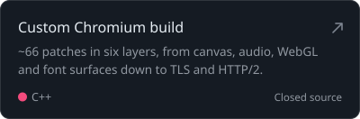
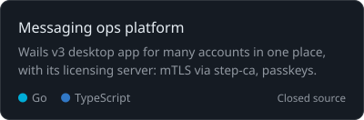
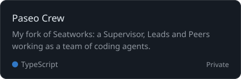
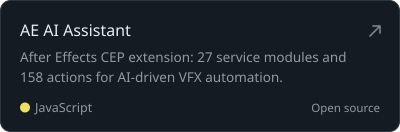
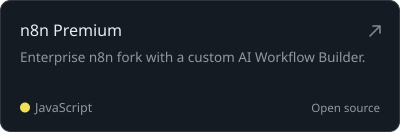
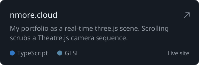
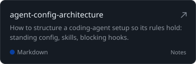

**[nmore.cloud](https://nmore.cloud)** &nbsp;·&nbsp; **[Email](mailto:huyquang29112001@gmail.com)** &nbsp;·&nbsp; `npx phquand` &nbsp;·&nbsp; Hanoi, Vietnam

I work *down* the stack rather than across it — from patching Chromium in C++ to driving those same browsers with AI agents. Most of what I build takes a system that was never built to be scripted and makes it programmable.

### Selected work

<a href="https://github.com/phquand2000/event-driven-go-notes"><picture><source media="(prefers-color-scheme: dark)" srcset="https://raw.githubusercontent.com/phquand2000/phquand2000/main/assets/cards/sourcing-dark.svg" /><source media="(prefers-color-scheme: light)" srcset="https://raw.githubusercontent.com/phquand2000/phquand2000/main/assets/cards/sourcing-light.svg" /></picture></a>
<a href="https://github.com/phquand2000/browser-fingerprint-surfaces"><picture><source media="(prefers-color-scheme: dark)" srcset="https://raw.githubusercontent.com/phquand2000/phquand2000/main/assets/cards/chromium-dark.svg" /><source media="(prefers-color-scheme: light)" srcset="https://raw.githubusercontent.com/phquand2000/phquand2000/main/assets/cards/chromium-light.svg" /></picture></a>
<picture><source media="(prefers-color-scheme: dark)" srcset="https://raw.githubusercontent.com/phquand2000/phquand2000/main/assets/cards/messaging-dark.svg" /><source media="(prefers-color-scheme: light)" srcset="https://raw.githubusercontent.com/phquand2000/phquand2000/main/assets/cards/messaging-light.svg" /></picture>
<picture><source media="(prefers-color-scheme: dark)" srcset="https://raw.githubusercontent.com/phquand2000/phquand2000/main/assets/cards/paseo-crew-dark.svg" /><source media="(prefers-color-scheme: light)" srcset="https://raw.githubusercontent.com/phquand2000/phquand2000/main/assets/cards/paseo-crew-light.svg" /></picture>
<a href="https://github.com/phquand2000/adobe_effects_ext"><picture><source media="(prefers-color-scheme: dark)" srcset="https://raw.githubusercontent.com/phquand2000/phquand2000/main/assets/cards/ae-assistant-dark.svg" /><source media="(prefers-color-scheme: light)" srcset="https://raw.githubusercontent.com/phquand2000/phquand2000/main/assets/cards/ae-assistant-light.svg" /></picture></a>
<a href="https://github.com/phquand2000/n8n_folk_premium"><picture><source media="(prefers-color-scheme: dark)" srcset="https://raw.githubusercontent.com/phquand2000/phquand2000/main/assets/cards/n8n-premium-dark.svg" /><source media="(prefers-color-scheme: light)" srcset="https://raw.githubusercontent.com/phquand2000/phquand2000/main/assets/cards/n8n-premium-light.svg" /></picture></a>
<a href="https://nmore.cloud"><picture><source media="(prefers-color-scheme: dark)" srcset="https://raw.githubusercontent.com/phquand2000/phquand2000/main/assets/cards/nmore-dark.svg" /><source media="(prefers-color-scheme: light)" srcset="https://raw.githubusercontent.com/phquand2000/phquand2000/main/assets/cards/nmore-light.svg" /></picture></a>
<a href="https://github.com/phquand2000/agent-config-architecture"><picture><source media="(prefers-color-scheme: dark)" srcset="https://raw.githubusercontent.com/phquand2000/phquand2000/main/assets/cards/agent-config-dark.svg" /><source media="(prefers-color-scheme: light)" srcset="https://raw.githubusercontent.com/phquand2000/phquand2000/main/assets/cards/agent-config-light.svg" /></picture></a>

Most of my work is closed source, so I publish the thinking instead. Happy to talk through the architecture.

### Guestbook

[**Sign it →**](https://github.com/phquand2000/phquand2000/issues/new?title=guestbook&body=Write%20your%20message%20here.%20It%20will%20appear%20on%20my%20profile%20with%20your%20username.) — an issue opens, you write a line, an Action puts it here and closes the issue.

<!-- guestbook starts -->

<!-- guestbook ends -->

  <picture>
    <source media="(prefers-color-scheme: dark)" srcset="https://raw.githubusercontent.com/phquand2000/phquand2000/output/github-snake-dark.svg" />
    <source media="(prefers-color-scheme: light)" srcset="https://raw.githubusercontent.com/phquand2000/phquand2000/output/github-snake.svg" />
    
  </picture>

