<picture>
  <source media="(prefers-color-scheme: dark)" srcset="https://raw.githubusercontent.com/phquand2000/phquand2000/main/assets/banner-dark.svg" />
  <source media="(prefers-color-scheme: light)" srcset="https://raw.githubusercontent.com/phquand2000/phquand2000/main/assets/banner-light.svg" />
  
</picture>

  <a href="https://nmore.cloud"><b>nmore.cloud</b></a> &nbsp;·&nbsp;
  <a href="mailto:huyquang29112001@gmail.com">Email</a> &nbsp;·&nbsp;
  <code>npx phquand</code> &nbsp;·&nbsp;
  Hanoi, Vietnam

I work *down* the stack rather than across it — from patching Chromium in C++ to
driving those same browsers with AI agents. Most of what I build takes a system that
was never built to be scripted (a browser, After Effects, n8n) and makes it
programmable.

### Where I work

<picture>
  <source media="(prefers-color-scheme: dark)" srcset="https://raw.githubusercontent.com/phquand2000/phquand2000/main/assets/stack-dark.svg" />
  <source media="(prefers-color-scheme: light)" srcset="https://raw.githubusercontent.com/phquand2000/phquand2000/main/assets/stack-light.svg" />
  
</picture>

The interesting problems live at the seams between those layers.

### Selected work

#### Browser internals

**Anti-detect browser engine** — custom Chromium build, ~66 patches organised into six
layers (de-telemetry, module, automation, fingerprint, network, branding). Spans canvas, audio,
WebGL and font surfaces through to TLS cipher ordering and HTTP/2 SETTINGS fingerprints.
`C++` · closed source — but the surface map is public: [browser-fingerprint-surfaces](https://github.com/phquand2000/browser-fingerprint-surfaces)

#### Distributed systems

**Sourcing & fulfillment platform** — 22 Go services across 10 bounded contexts. Connect
RPC over Buf-generated protos, one Postgres per service, NATS JetStream carrying
proto-encoded CloudEvents, transactional outbox, in-repo OIDC provider.
`Go` `TypeScript` · closed source — architecture notes: [event-driven-go-notes](https://github.com/phquand2000/event-driven-go-notes)

**Multi-account messaging desktop + licensing server** — a Wails v3 desktop app (Go + React)
that watches many messaging accounts in one place, read-only, and the server that licenses it:
a versioned Connect RPC contract, device enrollment and renewal over mTLS through step-ca,
a passkey-gated admin web, and a one-command synthetic E2E against a throwaway Postgres.
`Go` `TypeScript` · closed source

#### Agents & automation

**Paseo Crew** — my fork of Seatworks: a Paseo plugin that runs a team of coding agents.
A Supervisor splits the work into lanes, a Lead owns each lane and hands divisible parts to Peers;
backup seats on Codex take over when a Peer runs out of quota. `TypeScript` · private

**[AE AI Assistant](https://github.com/phquand2000/adobe_effects_ext)** — After Effects CEP
extension: 27 service modules and 158 registered actions for AI-driven VFX automation. `JavaScript`

**[n8n Premium](https://github.com/phquand2000/n8n_folk_premium)** — enterprise n8n fork
with a custom AI Workflow Builder. `JavaScript`

**[agent-config-architecture](https://github.com/phquand2000/agent-config-architecture)** — how to structure a
coding-agent setup so its rules actually hold: standing config, on-demand skills, blocking hooks.

#### Real-time graphics

**[nmore.cloud](https://nmore.cloud)** — my portfolio as a real-time three.js scene in React Three Fiber.
Scrolling scrubs a Theatre.js camera sequence instead of moving the page; custom GLSL and postprocessing.
`TypeScript` `GLSL`

Most of my work is closed source, so I publish the thinking instead. Happy to talk through the architecture.

### Reach me

[nmore.cloud](https://nmore.cloud) · [Email](mailto:huyquang29112001@gmail.com) — or `npx phquand`, if you would rather stay in
the terminal.

### Guestbook

[**Sign it →**](https://github.com/phquand2000/phquand2000/issues/new?title=guestbook&body=Write%20your%20message%20here.%20It%20will%20appear%20on%20my%20profile%20with%20your%20username.) — an issue opens, you write a line, an Action puts it here and closes the issue.

<!-- guestbook starts -->

<!-- guestbook ends -->

  <picture>
    <source media="(prefers-color-scheme: dark)" srcset="https://raw.githubusercontent.com/phquand2000/phquand2000/output/github-snake-dark.svg" />
    <source media="(prefers-color-scheme: light)" srcset="https://raw.githubusercontent.com/phquand2000/phquand2000/output/github-snake.svg" />
    
  </picture>

